# Chicken Jump

[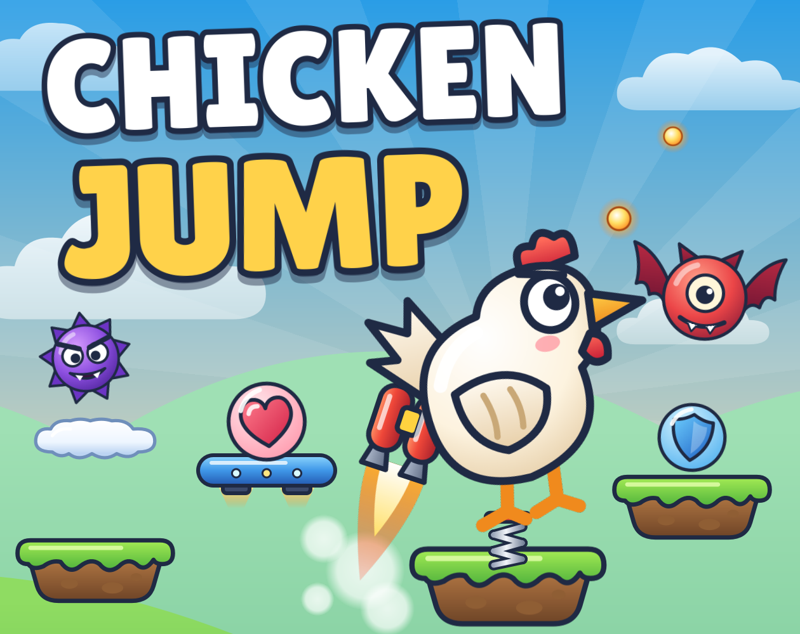](https://emilianostack.itch.io/chickenjump)

An endless arcade jumper made with Godot. Steer a bouncing chicken from platform to platform, up through day, sunset, night and into outer space.

**[Play it on itch.io](https://emilianostack.itch.io/chickenjump)** in your browser, on desktop or mobile.

## Screenshots

<table>
  <tr>
    <td align="center">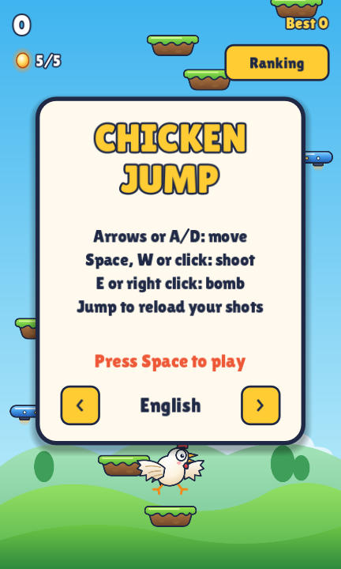<br>Main menu</td>
    <td align="center">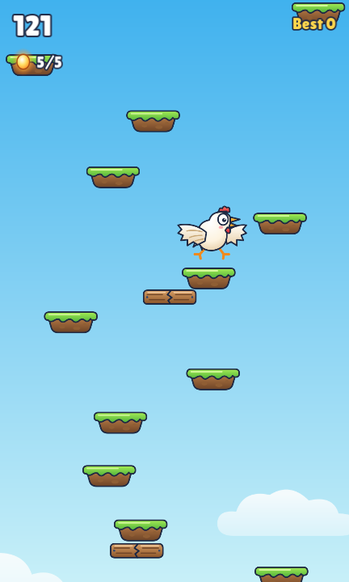<br>Daytime</td>
    <td align="center">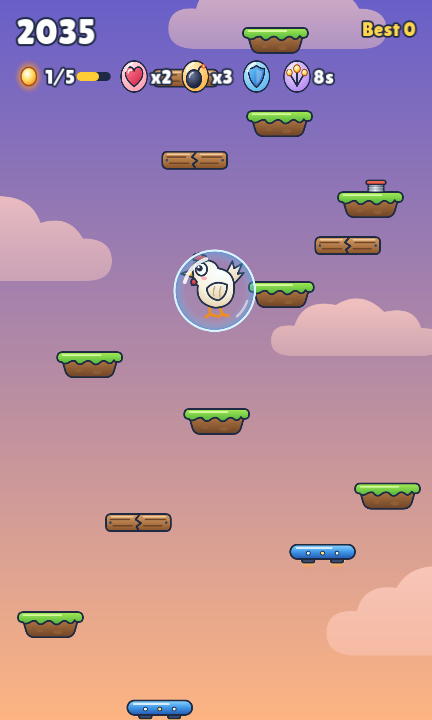<br>Sunset</td>
  </tr>
  <tr>
    <td align="center">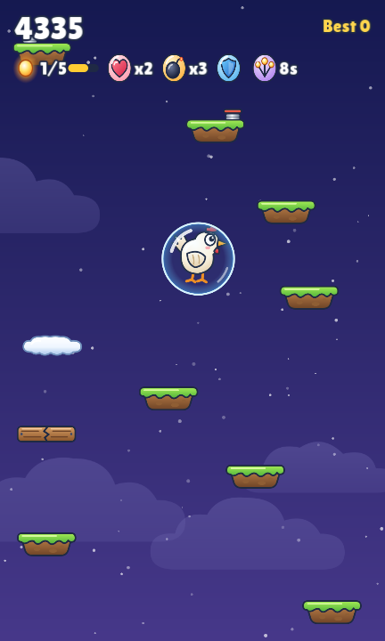<br>Night</td>
    <td align="center">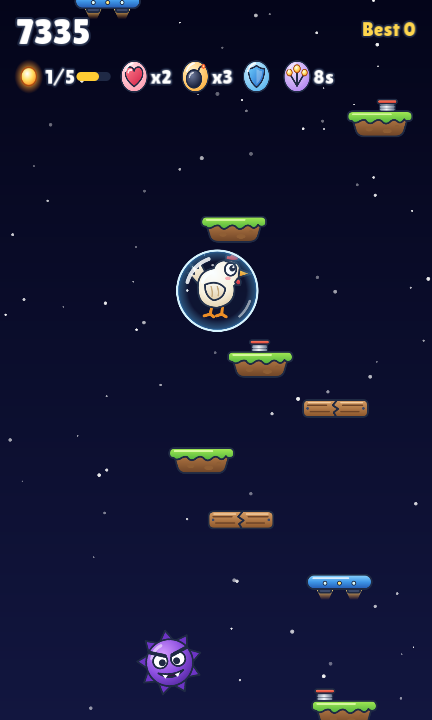<br>Outer space</td>
    <td align="center">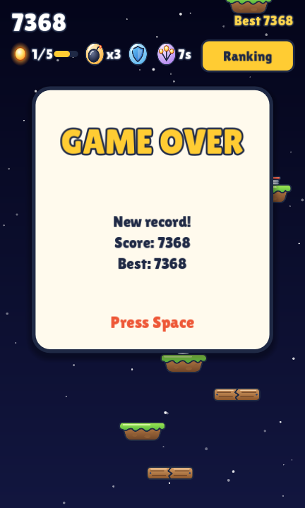<br>Game over</td>
  </tr>
</table>

Every platform, monster and power-up in one test scene:

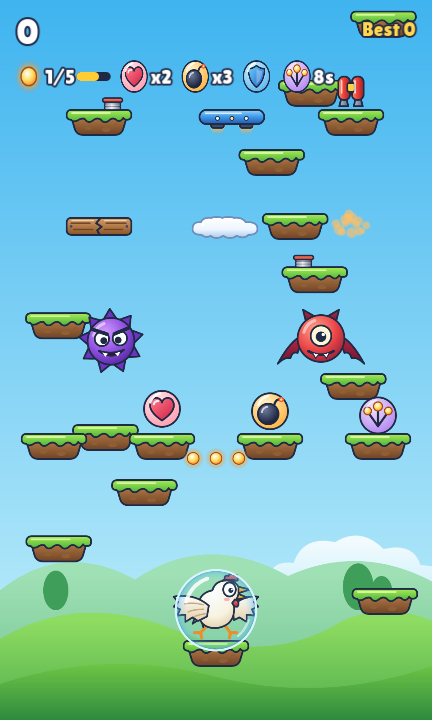

## Features

- Moving, crumbling and vanishing platforms
- Monsters you can shoot or stomp, with limited ammo that reloads as you jump
- Springs, jetpack, shield, extra lives, bombs and triple shot
- Difficulty that rises as you climb
- Best score saved on your device
- 9 languages: English, Portuguese, Spanish, French, German, Italian, Russian, Korean and Chinese

## Controls

| Action | Keyboard and mouse | Touchscreen |
| ------ | ------------------ | ----------- |
| Move | Left/Right arrows or A/D | On-screen buttons |
| Shoot | Space, W, Up arrow or left click | On-screen button |
| Bomb | E, Down arrow or right click | On-screen button |

## Sprites

All the art is vector, in SVG, and lives in [assets/](assets/).

### Chicken

<table>
  <tr>
    <td align="center">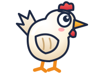<br>Rising</td>
    <td align="center">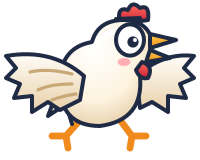<br>Falling</td>
    <td align="center">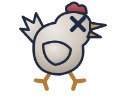<br>Defeated</td>
  </tr>
</table>

### Monsters

<table>
  <tr>
    <td align="center">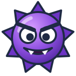<br>Spiky</td>
    <td align="center">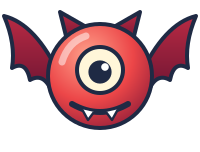<br>Bat, wings up</td>
    <td align="center">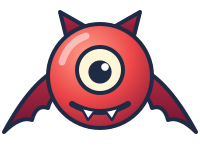<br>Bat, wings down</td>
  </tr>
</table>

### Platforms

<table>
  <tr>
    <td align="center"><br>Grass</td>
    <td align="center"><br>Moving</td>
    <td align="center"><br>Cloud</td>
    <td align="center"><br>Breakable, left</td>
    <td align="center"><br>Breakable, right</td>
  </tr>
</table>

### Power-ups and items

<table>
  <tr>
    <td align="center"><br>Jetpack</td>
    <td align="center"><br>Flame</td>
    <td align="center"><br>Shield</td>
    <td align="center"><br>Bubble</td>
    <td align="center"><br>Heart</td>
  </tr>
  <tr>
    <td align="center"><br>Bomb</td>
    <td align="center"><br>Triple shot</td>
    <td align="center"><br>Shot</td>
    <td align="center"><br>Spring</td>
    <td align="center"><br>Spring, released</td>
  </tr>
</table>

### Touch buttons and background

<table>
  <tr>
    <td align="center"><br>Left</td>
    <td align="center"><br>Right</td>
    <td align="center"><br>Shoot</td>
    <td align="center"><br>Bomb</td>
    <td align="center">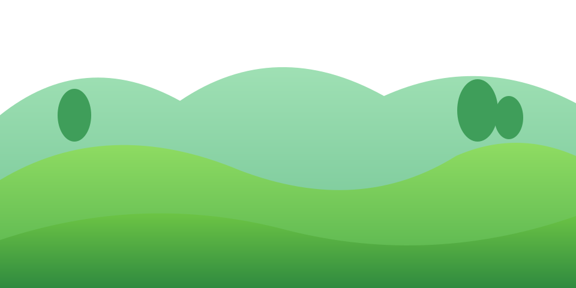<br>Hills</td>
  </tr>
</table>

## Run from source

1. Install [Godot 4.7](https://godotengine.org/download).
2. Clone this repository and open `project.godot` in Godot.
3. Press F5 to run the game.

On Windows, if Godot was installed with WinGet, `jogar.cmd` starts the game directly.

## Export

Install the Godot export templates, then run `exportar.ps1` on Windows. It creates `ChickenJump-web.zip` and `ChickenJump-windows.zip` in `build/`. The script looks for a Godot installed with WinGet.

## Tests

The tests are scripts in `tests/`. For example:

```
godot --headless --fixed-fps 60 --path . --script res://tests/bugs.gd
```

The usage of each test is at the top of its file.

## Licenses

Third-party licenses, including those for Godot and the fonts, are in [LICENSES.txt](LICENSES.txt).
